# QuantAI — Institutional Quantitative Market Intelligence Workstation

[](LICENSE)
[](https://www.typescriptlang.org/)
[](https://vitejs.dev/)
[](https://react.dev/)
[](https://github.com/yuvadevlab/devlab-shared)

**Author:** `yuva.devlab@gmail.com`  
**Standard:** Pure Platform CSS, W3C Cascade Layers (`@layer dl-*`), `@yuva-devlab/tokens`

**QuantAI** is an institutional-grade algorithmic intelligence and predictive market surveillance workstation built for the **National Stock Exchange (NSE)** and **Bombay Stock Exchange (BSE)**. It provides real-time multi-agent market regime classification, automated high-conviction predictive signal ledgers, live Monte Carlo trajectory cone comparisons, and risk-managed paper portfolio tracking.

---

## 📚 Documentation & Multi-Agent Guides

- 📖 **[Master Documentation Index](./docs/INDEX.md)** — Complete 14-chapter architecture, domain knowledge, and API reference.
- 🤖 **[AGENTS.md](./AGENTS.md)** — Master engineering standards and invariants for all AI coding agents.
- ♊ **[GEMINI.md](./GEMINI.md)** — Google Antigravity & Gemini CLI specific instruction adapter.
- 🟣 **[CLAUDE.md](./CLAUDE.md)** — Claude Code specific instruction adapter.
- 🐙 **[Copilot Instructions](.github/copilot-instructions.md)** — GitHub Copilot & VS Code agent mode configuration.
- 📋 **[CONTRIBUTING.md](./CONTRIBUTING.md)** — Branching models, commit conventions, and PR checklist.
- 🛡️ **[SECURITY.md](./SECURITY.md)** — Capital safety, air-gapped broker policy, and data integrity.
- 🚀 **[IMPLEMENTATION.md](./IMPLEMENTATION.md)** — Phased roadmap, deliverables, and acceptance criteria.

---

## 🏛️ System Architecture

```mermaid
graph TD
    Client["Trader Browser (Desktop / Tablet / Mobile)"]

    subgraph Workstation Presentation
        Root["Root Layout & Theme Provider"]
        Shell["QuantShell (Responsive Canvas & Safe Insets)"]
        Sidebar["QuantSidebar (Terminal Navigation)"]
        Topbar["QuantTopbar (Regime Pulse, Win Rate KPI)"]
        Ticker["MarketTickerStrip (Live NSE Streaming Strip)"]
    end

    subgraph Analytics & Intelligence Desks
        Overview["Overview Desk (Market Breadth & Sector Momentum)"]
        Predictions["Predictions Lab (Signal Ledger & Excursions)"]
        Monitor["Monitor Desk (Monte Carlo Cone vs Live Actual)"]
        Screener["Quant Screener (Breakouts & Options OI Skew)"]
        Portfolio["Paper Portfolio (Risk Engine & Beta Attribution)"]
        Copilot["AI Financial Copilot (Multi-Agent Deliberation)"]
    end

    subgraph Design & Token Primitives
        Tokens["@yuva-devlab/tokens (Obsidian / Cyan OKLCH)"]
        LayoutTokens["src/styles/layout-tokens.css (3-Tier Responsive)"]
        SharedUI["@yuva-devlab/ui (Semantic Primitives)"]
        CopyCatalog["src/lib/ui-copy/ (Zero Hardcoded Strings)"]
    end

    Client --> Root
    Root --> Shell
    Shell --> Sidebar
    Shell --> Topbar
    Shell --> Ticker
    Shell --> Overview
    Shell --> Predictions
    Shell --> Monitor
    Shell --> Screener
    Shell --> Portfolio
    Shell --> Copilot

    Shell -.-> Tokens
    Shell -.-> LayoutTokens
    Shell -.-> SharedUI
    Shell -.-> CopyCatalog
```



---

## 🎯 Key Capabilities

- **Executive Market Desk**: Real-time surveillance of major Indian benchmark indices (`NIFTY 50`, `BANKNIFTY`, `MIDCPNIFTY`, `SENSEX`, and `INDIA VIX`), market breadth (Advances/Declines), and FII/DII institutional net flows.
- **Predictions Lab & Signal Ledger**: Transparent audit ledger of all automated AI trading recommendations with calibrated win-rate metrics, Maximum Favorable Excursion (MFE), and Maximum Adverse Excursion (MAE).
- **Live Trajectory Monitor**: High-precision visual overlay of actual market price ticks against predictive Monte Carlo confidence cone bounds (`Target 1`, `Target 2`, `Stop Loss`).
- **Autonomous Multi-Agent Consensus**: Granular consensus breakdown across four specialized algorithmic agents:
  1. _Macro & Monetary Policy Agent_
  2. _Quantitative & Technical Momentum Agent_
  3. _Options Flow & Volatility Surface Agent_
  4. _Chief Risk Guardian Agent_
- **Quantitative Factor Screener**: Scan 2,000+ Indian equities for technical breakouts, 20/50 EMA crosses, and aggressive options Open Interest (OI) buildup.
- **Paper Trading & Risk Management**: Simulated algorithmic execution with virtual ₹10,00,000 capital, automated trailing stops, and portfolio drawdown protection.

---

## 💻 Tech Stack & Engineering Standards

- **Core Framework**: React 19 + TanStack Start + Vite 8 (Ultra-fast 50ms HMR, SSR with Nitro).
- **Styling Architecture**: Pure Platform CSS with W3C Cascade Layers (`@layer dl-tokens`, `@layer dl-components`, `@layer dl-utilities`). Zero utility-first CSS frameworks.
- **Design Tokens**: Standardized OKLCH color definitions and domain extensions via `@yuva-devlab/tokens`.
- **Responsive Sizing**: 3-tier mobile-first fluid scaling (Mobile `<768px`, Tablet `768px–1023px`, Desktop `1024px+`) with WCAG 2.5.5 touch target minimums (`44px` / `2.75rem`).
- **Type Safety**: TypeScript 5.9 with strict enums (`SignalStatus`, `SignalDirection`, `MarketIndex`) over raw string unions.
- **UI Copy Isolation**: Zero hardcoded strings. All user-facing labels, headings, and disclaimer notices flow from `src/lib/ui-copy/`.

---

## 🚀 Quick Start

### Prerequisites

- Node.js `>= 22.0.0`
- pnpm `>= 9.0.0`

### Installation & Development

```bash
# Install dependencies
pnpm install

# Start local workstation development server (port 3005)
pnpm dev

# Typecheck and lint
pnpm typecheck
pnpm lint

# Format code
pnpm format:check
pnpm format

# Production build
pnpm build
```

---

## ⚖️ Regulatory Notice

QuantAI is an advanced quantitative research, mathematical modeling, and algorithmic intelligence environment built strictly for educational, informational, and paper-tracking purposes. QuantAI is NOT a registered financial advisory, SEBI-registered research analyst, or portfolio manager. Please consult a SEBI-registered financial advisor before undertaking any live trading decisions.

---

## 📬 Attribution & Maintainer

- **Organization**: Yuva DevLab
- **Maintainer**: `yuva.devlab@gmail.com`
- **License**: MIT
