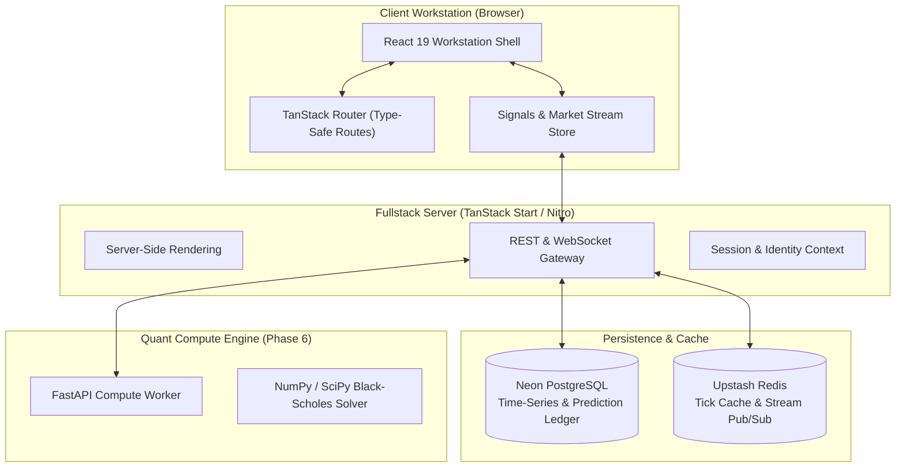

# 02 — System Architecture & Layer Boundaries

**Author:** `yuva.devlab@gmail.com`  
**Parent Index:** [docs/INDEX.md](../INDEX.md)

---

## 1. High-Level Architecture

QuantAI is structured as a modern fullstack workstation powered by **TanStack Start** (React 19, Vite, Nitro SSR) coupled with isolated background compute services:



---

## 2. Monorepo Directory Boundaries

```
quant-ai/
├── pnpm-workspace.yaml            # Targets apps/* and packages/*
├── docker-compose.yml             # Local dev orchestrator (workstation:3005, quant-engine:8000)
│
├── apps/
│   ├── web/                       # @quant-ai/web (TanStack Start / React 19 UI & SSR)
│   │   ├── src/components/layout/ # QuantShell, QuantSidebar, QuantTopbar, MarketTickerStrip
│   │   ├── src/features/          # Domain views: Overview, Predictions, Monitor, Screener, Copilot
│   │   ├── src/services/          # Market feed & client signal streaming adapters
│   │   ├── src/lib/ui-copy/       # Centralized UI Copy Catalogs (Zero hardcoded strings)
│   │   └── src/routes/            # Thin TanStack Router endpoints
│   └── api/                       # @quant-ai/api (NestJS Enterprise REST & WebSocket Gateway)
│       └── src/modules/           # Market, Predictions, Screener, QuantAnalysis, Realtime, Infrastructure
│
├── packages/
│   ├── shared-types/              # @quant-ai/shared-types (SSOT domain enums, endpoints, query keys, math)
│   ├── events/                    # @quant-ai/events (Domain event envelopes powered by @yuva-devlab/events)
│   ├── database/                  # @quant-ai/database (Prisma ORM schema, repositories & PostgreSQL client)
│   └── ui/                        # @quant-ai/ui (Domain UI components styled via W3C cascade layers)
│
└── services/
    └── quant-engine/              # Python FastAPI & NumPy Vectorized Compute Service
        ├── pyproject.toml         # Python 3.12 + FastAPI + NumPy + SciPy (managed by uv)
        ├── Dockerfile             # Scale-to-zero container for Cloud Run
        ├── src/main.py            # FastAPI REST entrypoint
        └── src/monte_carlo.py     # Vectorized Geometric Brownian Motion simulation
```

---

## 3. Styling Paradigm: 90/10 Pure Platform CSS

- **90% Semantic Component Architecture**: Styling is defined under `@layer dl-components` using semantic classes (`.quant-card`, `.signal-badge`, `.waveform-svg`).
- **10% Macro Layout Glue**: Atomic utilities (`@layer dl-utilities`) are strictly reserved for page-level grids and flex wrappers.
- **Design Tokens**: Parameterized via `@yuva-devlab/tokens` institutional `quantai` palette (Cyan `oklch(0.72 0.14 210)` and Obsidian `oklch(0.12 0.02 240)`).
- Zero third-party utility frameworks are permitted.
