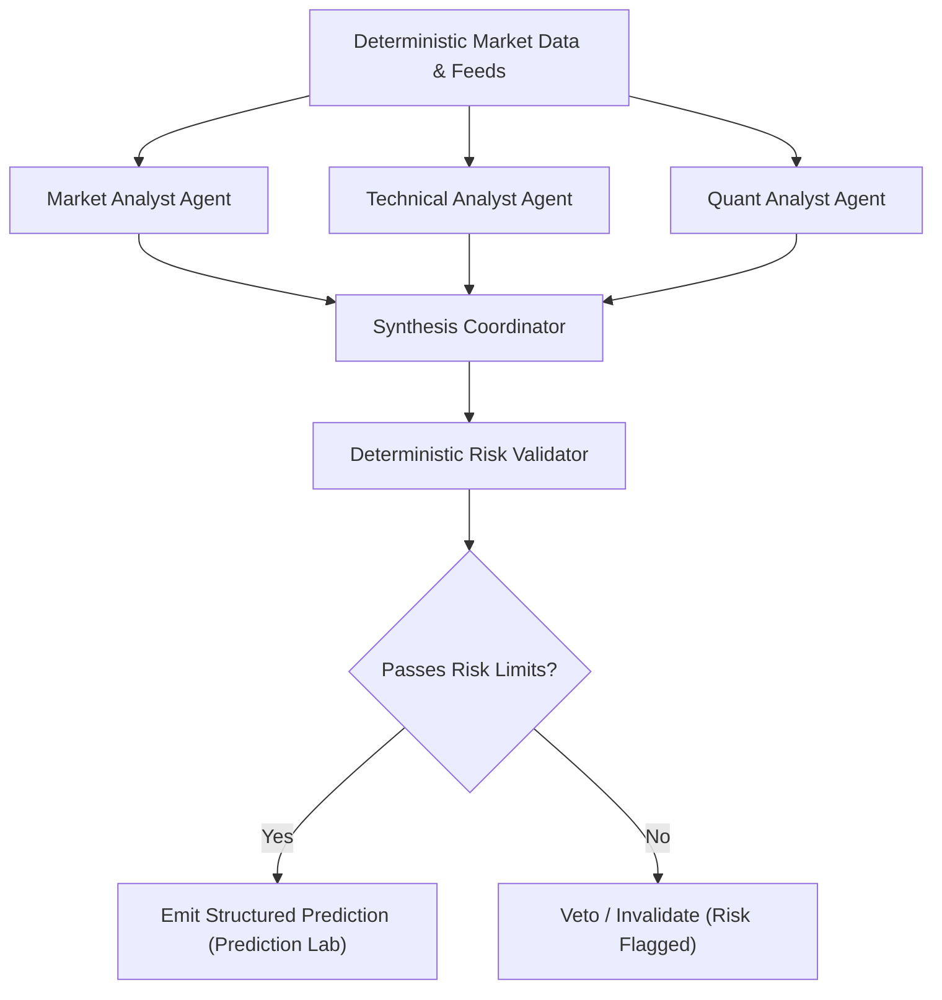

# 06 — AI Engineering & Multi-Agent Deliberation

**Author:** `yuva.devlab@gmail.com`  
**Parent Index:** [docs/INDEX.md](../INDEX.md)

---

## 1. Multi-Agent Ecosystem

Rather than relying on a single monolithic prompt, QuantAI organizes analysis into distinct, specialized analytical personas:

---

## 2. Specialized Roles

1. **Market Analyst**: Evaluates macro backdrop, sector rotation, market breadth, and economic releases.
2. **Technical Analyst**: Identifies support/resistance, trendlines, chart patterns, and momentum oscillators.
3. **Quant Analyst**: Assesses statistical regime, volatility cones, and probabilistic distribution of price movements.
4. **Risk Validator (Deterministic Engine)**: Checks maximum drawdown, risk/reward ratio minimums (>= 1.5), portfolio correlation, and event risk.

---

## 3. Hallucination Guardrails

- **Zero Fabricated Prices**: Agents never invent price quotes. Indicators are computed by math engines and injected into agent context.
- **Divergence Over Consensus**: When technical and quant models disagree, the system highlights the disagreement rather than synthesizing false conviction.
